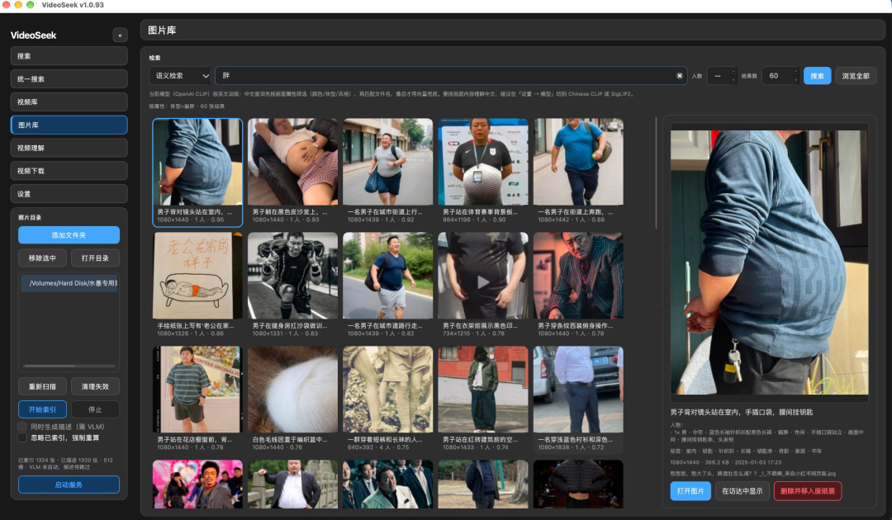

> **Archived (2026-11-06)**: This branch is no longer maintained. It stays
> public and read-only, and the source remains available under **AGPL-3.0**.
> Further work on local asset tooling has moved to a separate project designed
> from an empty repository and rewritten natively in Swift, with no shared code.
> Thanks to upstream [6v17/VideoSeek](https://github.com/6v17/VideoSeek).

---

# VideoSeek — The video editor's asset search engine

> **A local asset search engine for video editors**: describe a shot in one sentence and find the right clip or image in your local library within a minute. Everything runs locally — your media is never uploaded.

<p align="center">
  
</p>

---

## How long do you spend finding footage?

**Finding footage is the most time-wasting, least rewarding part of editing.**

- You have a picture in your head: "a woman in a red dress by a window", "a stocky guy walking down the street", "a sunset at the beach"
- But your library has dozens of folders, tens of thousands of images, hundreds of videos — and the filenames are `IMG_0347.jpg`, `素材_最终版_v3.mp4`
- So you open folder after folder, image after image — **half an hour later, still no match**

**VideoSeek compresses that to one minute.**

Type "woman in a red dress", "stocky person", "sunset beach" — and it pulls the exact image or clip out of your local library.

**Finding footage: from 10–30 minutes → about 1 minute. Over 90% of the time gone.**

---

## How it works

VideoSeek doesn't search filenames — it **understands what's in the frame**.

| You type (plain language) | VideoSeek returns |
|---------------------------|-------------------|
| "woman in a red dress" | The exact image (even if it's named `IMG_0347.jpg`) |
| "stocky person", "light clothes" | Photos filtered by body type and clothing color |
| "sunset beach", "meeting room whiteboard" | Semantic understanding of the whole frame |
| A screenshot | Reverse image search for the same composition / scene |

### What it does for you

- ❌ No **manual tagging** — captions are auto-generated
- ❌ No **memorizing filenames** — describe the content, not the name
- ❌ No **digging through folders** — one box searches video + image + documents
- ❌ No **re-indexing** — new assets update incrementally, in seconds
- ❌ No **uploading** — everything runs locally, nothing leaves your machine

---

## One pipeline, two tools: 1 hour → 10 minutes

VideoSeek is the front half of the **talking-head editing pipeline**: finding footage.

Paired with the author's **independently developed talking-head auto-cut pipeline** (breath cutting, repetition removal, speaker separation — a standalone tool fully decoupled from this repository and not using any VideoSeek code), the whole flow looks like this:

```
Talking-head rough cut (was ~1 hour)
  ├─ ① Auto-cut breaths & remove repeated lines   ← standalone talking-head tool
  ├─ ② Find B-roll images & clips from local lib  ← VideoSeek
  └─ ③ Export
```

| Step | Before | After |
|------|--------|-------|
| Cut breaths + remove repetition | Manual, clip by clip | Automatic |
| Find B-roll images / clips | 10–30 min | ~1 min |
| **Total per talking-head video** | **~1 hour** | **~10 min** |

**50 minutes saved per video. ~83% less time.**

---

## Who it's for

- ✅ **Video editors / creators**: the bigger your library, the more you need it
- ✅ **Talking-head, knowledge / course editors**: faster B-roll means faster output
- ✅ **Anyone with a large local library** of images, videos, and PDFs: your own "local Google Images"

---

## Core capabilities

| Capability | Description |
|------------|-------------|
| **Video semantic search** | Describe a shot, screenshot search, hard-subtitle OCR |
| **Photo library** | Semantic image index + auto Chinese captions + people tags |
| **Document library (PDF)** | Search text inside PDFs, locate to the page, continuous scroll preview |
| **Unified search** | One box searches video + image + document |
| **Chinese image search** | Attribute + text + vector routing; Chinese just works |
| **Fully local** | ONNX + Lance + FFmpeg, nothing uploaded |

---

## Quick start

> **Requirements: an Apple Silicon Mac (M1 or later), macOS 13 Ventura or newer.**
> arm64 native only — **Intel Macs are not supported, and running under Rosetta is not supported.** The AI stack (ONNX Runtime / FAISS / LanceDB) ships arm64-native wheels; the wrong architecture silently falls back to Rosetta and runs several times slower without any error. The installer validates the Python architecture and rejects non-arm64 interpreters.

1. Double-click **`install-macos.command`** to install dependencies (5–15 min first run)
2. Import models (`openai-clip.zip` + `rapidocr-zh-understanding.zip`)
3. Double-click **`run-macos.command`**, add asset folders → start indexing → search

Full setup in [`docs/quickstart.md`](docs/quickstart.md).

---

## Documentation

- [`docs/quickstart.md`](docs/quickstart.md) — from-source install
- [`docs/image-library.md`](docs/image-library.md) — photo library
- [`docs/pdf-search-plan.md`](docs/pdf-search-plan.md) — document library (PDF)
- [`docs/changelog.md`](docs/changelog.md) — changelog

---

## Credits & license

This project is built on [6v17/VideoSeek](https://github.com/6v17/VideoSeek) by [@6v17](https://github.com/6v17) — with thanks.

**License: [AGPL-3.0](LICENSE)**. All modifications are released under the same AGPL-3.0 license.

<details>
<summary>Support the original author</summary>

<p align="center">
  
</p>

</details>

