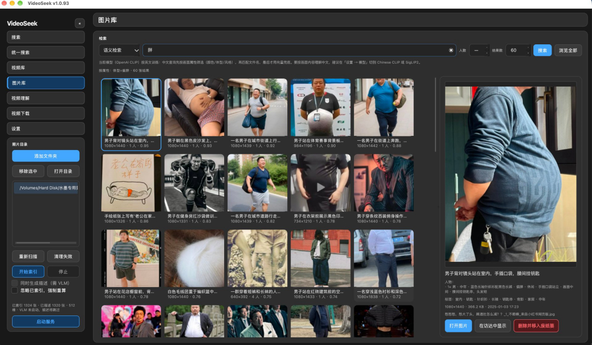

# VideoSeek · macOS

[](LICENSE)
[](docs/macos-notes.md)
[](https://github.com/6v17/VideoSeek)

**中文** | [English](./README.en.md)

---

**本地视频 + 图片语义搜索**：用一句话或一张截图，就能从你的素材库里找到想要的镜头和图片。全程在本机完成，素材不上传。

<p align="center">
  
</p>

> 上图：在图片库里搜「胖」，就能精准找出对应的人物照片，无需记文件名、无需打标签。

---

## 一眼看懂：这个分支解决了什么

### 原作者的不足

原项目 [6v17/VideoSeek](https://github.com/6v17/VideoSeek) 很强，但它有几个明显的短板：

| 短板 | 说明 |
|------|------|
| ❌ **只能搜视频** | 图片、截图、素材图完全搜不了，而做视频的人一半素材是图片 |
| ❌ **只支持 Windows** | macOS 用户装不上、跑不起来 |
| ❌ **中文搜图基本失灵** | 默认模型只认英文，搜「红酒瓶」会返回表情包 |
| ❌ **索引要整库重跑** | 新加一张图也要把整个库重新建一遍 |
| ❌ **安装繁琐** | 每次都要手动跑命令、配置环境 |

### 我做了什么

在这个 macOS 分支里，我把上面的短板一一补齐：

- ✅ **新增图片库** —— 图片、截图、素材图也能建语义索引，还能自动生成中文描述和人物标签
- ✅ **中文搜图** —— 说人话就能搜：`穿红裙的女人`、`胖的人`、`浅色衣服`，问的是画面内容而不是文件名
- ✅ **统一搜索** —— 一个输入框同时搜视频和图片，结果分组展示
- ✅ **增量索引** —— 新加素材只索引新增部分，不用整库重跑
- ✅ **双击即用** —— 打包成 macOS 应用，双击图标直接启动，不用碰命令行
- ✅ **界面顺手** —— 图片可直接拖进剪映，右键删除（进废纸篓）、一键启动描述服务

### 我的厉害之处

> 核心就一句：**让「找素材」这件事，快到你忘了它的存在。**

- 🔍 **搜得准**：语义检索 + 属性筛选（颜色 / 体型 / 风格）+ 中文三级路由，1262 张素材实测黑色 12/12、浅色 10/12 命中
- ⚡ **快**：一次索引，之后每次搜索毫秒级；增量更新，越用越顺手
- 🔒 **纯本地**：ONNX + Lance + FFmpeg 全程本机跑，素材一张都不上传
- 🖱️ **顺手**：拖拽导入剪映、右键管理、一键启动服务，剪视频的人用起来没有学习成本

---

## 快速开始

### 1. 装依赖（双击即可）

在 Finder 里双击 **`install-macos.command`**，脚本会自动挑 Python、建虚拟环境、走国内镜像装依赖。首次 5–15 分钟。

> 前提：需要先装 Xcode 命令行工具、Homebrew 的 Python 3.13 和 FFmpeg（装 VLC 可预览播放）。

### 2. 导入模型

从 [Releases — models](https://github.com/6v17/VideoSeek/releases/tag/models) 下载 `openai-clip.zip` 和 `rapidocr-zh-understanding.zip`，然后：

```bash
~/.videoseek-venv/bin/python scripts/import_runtime_resources.py openai-clip.zip rapidocr-zh-understanding.zip
```

（也可以在应用内用「导入并解析」完成同样的事。）

### 3. 启动

双击 **`run-macos.command`**，然后在应用里：**视频库 / 图片库** → 添加文件夹 → 开始索引 → 搜索。

完整细节见 [`docs/quickstart.md`](docs/quickstart.md)。

---

## 主要功能一览

| 功能 | 说明 |
|------|------|
| **视频语义搜索** | 文字描述找镜头，截图搜视频，硬字幕 OCR |
| **图片库** | 图片语义索引 + 自动中文描述 + 人物标签（[详情](docs/image-library.md)） |
| **统一搜索** | 一个框同时搜视频 + 图片 |
| **中文搜图** | 属性筛选 + 文字 + 向量三级路由，中文不再失灵 |
| **导出** | MP4 / 剪映草稿 / 达芬奇 / Premiere，拖拽即可导入 |

---

## 与上游的差异

本分支**只做 macOS 平台适配和图片能力增强**，视频索引、搜索、导出等核心链路与上游保持一致。主要改动：

- 新增独立的**图片库**（独立索引表，不动视频索引一行）
- 新增**统一搜索**（视频 + 图片）
- FFmpeg 增加 Mach-O 识别（否则 macOS 上会误判"没有 FFmpeg"）
- 复用系统 VLC 的 libvlc 做播放
- 打包成 `.app` + 图标，双击启动
- 全中文 macOS 文档

详细差异清单见 [`docs/macos-notes.md`](docs/macos-notes.md)。

---

## 文档

- [`docs/quickstart.md`](docs/quickstart.md) — 从源码安装
- [`docs/image-library.md`](docs/image-library.md) — 图片库：数据模型、三种检索、人物描述
- [`docs/unified-search.md`](docs/unified-search.md) — 统一搜索
- [`docs/changelog.md`](docs/changelog.md) — 改动与 Bug 记录

---

## 致谢与许可

- 原始项目、全部核心实现：**[@6v17](https://github.com/6v17)** — <https://github.com/6v17/VideoSeek>
- 本分支只做平台适配与图片能力增强，Windows 相关请去上游。

许可：[AGPL-3.0](LICENSE) © 2026 [6v17](https://github.com/6v17)。

<details>
<summary>支持原作者</summary>

<p align="center">
  
</p>

</details>

## 支持这个 macOS 分支

如果你觉得这个 macOS 分支帮到了你，欢迎请我喝杯咖啡：

<p align="center">
  
</p>

<p align="center">
  左：微信赞赏码　右：支付宝转账码
</p>
